# Cineora

Cineora adalah aplikasi penjelajah film untuk Android dan iOS yang dibangun dengan Flutter dan data dari [OMDb API](https://www.omdbapi.com/). Pengguna bisa menjelajah dan mencari katalog OMDb, membuka detail lengkap sebuah judul, lalu menyimpannya ke daftar favorit yang tersimpan di perangkat dan tetap bisa dibuka tanpa koneksi.

Proyek ini dibuat untuk **Mobile Developer Competency Test** dengan arsitektur MVVM di atas GetX.

---

<a id="daftar-isi"></a>
## Daftar Isi

1. [Ringkasan](#ringkasan)
2. [Fitur](#fitur)
   - [Daftar film](#fitur-daftar-film)
   - [Pencarian live](#fitur-pencarian)
   - [Detail film](#fitur-detail)
   - [Favorit](#fitur-favorit)
   - [State UI: loading, kosong, error](#fitur-state)
3. [Tangkapan layar](#tangkapan-layar)
   - [Android](#tangkapan-layar-android)
   - [iOS](#tangkapan-layar-ios)
   - [Kondisi lain](#tangkapan-layar-lain)
4. [Teknologi](#teknologi)
5. [Arsitektur](#arsitektur)
   - [Lapisan MVVM](#arsitektur-lapisan)
   - [Dependency injection (Bindings)](#arsitektur-bindings)
   - [Routing dan navigasi](#arsitektur-routing)
6. [Struktur folder](#struktur-folder)
7. [Cara kerja fitur utama](#cara-kerja)
   - [Pagination 20 judul per batch](#cara-kerja-pagination)
   - [Debounce dan respons usang](#cara-kerja-debounce)
   - [Sinkronisasi favorit antar halaman](#cara-kerja-sinkronisasi)
   - [Akses offline](#cara-kerja-offline)
8. [Desain UI](#desain-ui)
   - [Palet warna](#desain-palet)
   - [Glassmorphism](#desain-glass)
   - [Tipografi dan animasi](#desain-tipografi)
   - [Aksesibilitas](#desain-aksesibilitas)
   - [Responsif](#desain-responsif)
9. [Shared widgets](#shared-widgets)
10. [Konfigurasi environment](#konfigurasi-environment)
11. [Instalasi dan menjalankan](#instalasi)
12. [Build rilis, nama, dan icon aplikasi](#build-rilis)
13. [Pengujian](#pengujian)
14. [Penanganan error](#penanganan-error)
15. [Pemecahan masalah](#pemecahan-masalah)
16. [Pemenuhan requirement](#pemenuhan-requirement)
17. [Batasan yang diketahui](#batasan)

---

<a id="ringkasan"></a>
## 1. Ringkasan

| Hal | Keterangan |
| --- | --- |
| Nama aplikasi | Cineora |
| Platform | Android, iOS |
| Framework | Flutter (Dart 3.12) |
| Arsitektur | MVVM dengan GetX, struktur modul GetX CLI |
| Sumber data | OMDb API (`?s=` untuk pencarian, `?i=` untuk detail) |
| Penyimpanan lokal | GetStorage |
| Konfigurasi | Envied (`.env`, key diobfuskasi) |

[↑ Kembali ke daftar isi](#daftar-isi)

---

<a id="fitur"></a>
## 2. Fitur

<a id="fitur-daftar-film"></a>
### Daftar film

- Saat dibuka, aplikasi menampilkan **20 judul**. OMDb hanya mengembalikan 10 judul per halaman, jadi setiap batch mengambil dua halaman.
- Setiap kartu menampilkan poster, judul, tahun rilis, dan tipe (Movie, Series, Episode).
- Setiap judul diidentifikasi dengan **IMDb ID**.
- Infinite scroll memuat 20 judul berikutnya sebelum pengguna mencapai akhir daftar. Pemuatan berhenti di `totalResults` dari OMDb atau di halaman 100 (batas OMDb).
- Judul dengan IMDb ID yang sama di halaman berbeda tidak ditampilkan dua kali.
- Pull-to-refresh untuk memuat ulang daftar.
- Poster yang tidak tersedia (`"N/A"`) diganti dengan tile "No poster".
- Hasil pertama ditampilkan sebagai kartu **Top result** yang lebih besar.
- Saat aplikasi dibuka, tidak ada filter pencarian yang aktif. Daftar awal berjudul "Start browsing".

<a id="fitur-pencarian"></a>
### Pencarian live

- Kolom pencarian ada langsung di Home dan tetap terlihat (pinned) saat daftar di-scroll.
- **Debounce 450 ms**: permintaan baru dikirim setelah pengguna berhenti mengetik.
- Input kurang dari 2 huruf tidak dikirim ke API. Pengguna melihat petunjuk "Type at least 2 letters to search."
- Mengulang kata kunci yang sama tidak memicu permintaan baru.
- Respons dari pencarian lama tidak pernah menimpa hasil yang lebih baru. Lihat [Debounce dan respons usang](#cara-kerja-debounce).
- Tombol × untuk menghapus pencarian dan kembali ke daftar awal.
- Chip pencarian cepat (Star, Batman, Love, Night, Dragon, Ocean) menjalankan pencarian sungguhan. Chip hanya ditandai aktif jika pengguna memilihnya atau mengetik kata yang sama.
- Keyboard tertutup otomatis saat daftar di-scroll.

<a id="fitur-detail"></a>
### Detail film

- Data diambil dengan `?i=<imdbID>&plot=full`.
- Menampilkan poster, judul, tanggal rilis, durasi, rating IMDb dan jumlah vote, klasifikasi umur, genre, sinopsis, sutradara, penulis, pemeran, bahasa, negara, dan penghargaan.
- Kolom yang bernilai `N/A` di OMDb disembunyikan.
- Poster berpindah dari kartu ke halaman detail dengan animasi Hero.
- Latar header memakai poster yang di-blur sehingga setiap film punya nuansa warna sendiri.
- Judul dan poster dari daftar tampil langsung, sementara data lengkap dimuat dengan skeleton.
- Tombol favorit tersedia di pojok kanan atas dan di bawah judul.

<a id="fitur-favorit"></a>
### Favorit

- Tambah atau hapus favorit dari kartu di Home, kartu Top result, atau halaman detail.
- Disimpan dengan **GetStorage**, sehingga tetap ada setelah aplikasi ditutup dan dibuka lagi.
- Disimpan dengan kunci IMDb ID, sehingga tidak ada data ganda.
- Status favorit tersinkron langsung di Home, Detail, dan Favorites.
- Halaman Favorites menampilkan jumlah judul yang tersimpan, diurutkan dari yang terbaru.
- Menghapus favorit menampilkan snackbar dengan tombol **Undo**.
- Empty state menyediakan tombol "Browse movies" untuk kembali ke tab Discover.
- Favorit bisa dibuka tanpa koneksi. Lihat [Akses offline](#cara-kerja-offline).

<a id="fitur-state"></a>
### State UI: loading, kosong, error

| Kondisi | Tampilan |
| --- | --- |
| Memuat | Skeleton dengan efek shimmer (berhenti jika sistem meminta reduced motion) |
| Tidak ada hasil | "No titles match “…”" dengan tombol Clear search |
| Offline | "You appear to be offline" dengan tombol Try again |
| API key kosong | "OMDb API key missing" beserta langkah perbaikan |
| API key ditolak | "OMDb rejected the API key" |
| Kuota habis | "Daily request limit reached" |
| Terlalu banyak hasil | "Too many matches", meminta pengguna menambah huruf |
| Gagal memuat halaman berikutnya | Pesan singkat dengan tombol Retry di bawah daftar |
| Akhir daftar | "That is every match OMDb has for “…”." |
| Favorites kosong | "Nothing saved yet" dengan tombol Browse movies |

[↑ Kembali ke daftar isi](#daftar-isi)

---

<a id="tangkapan-layar"></a>
## 3. Tangkapan layar

Semua gambar diambil dari aplikasi yang berjalan dengan data asli OMDb.

- [Android](#tangkapan-layar-android)
- [iOS](#tangkapan-layar-ios)
- [Kondisi lain](#tangkapan-layar-lain)

<a id="tangkapan-layar-android"></a>
### Android

Emulator Pixel 4, Android 17 (API 37).

| Discover | Grid poster | Detail |
| --- | --- | --- |
| 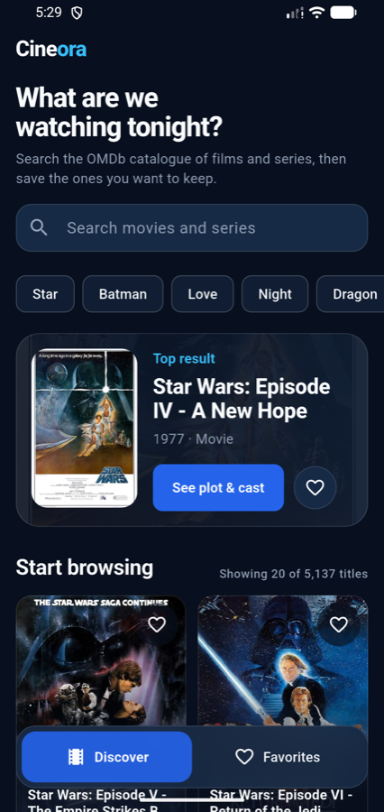 | 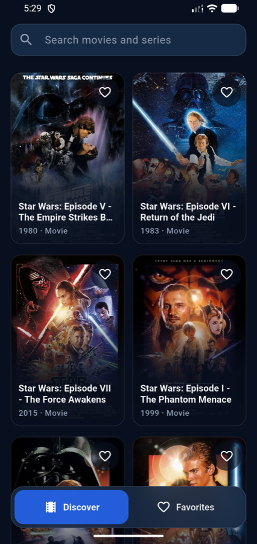 | 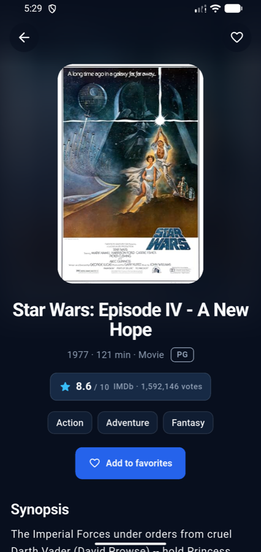 |

| Sinopsis & kredit | Favorites | Pencarian "Batman" |
| --- | --- | --- |
| 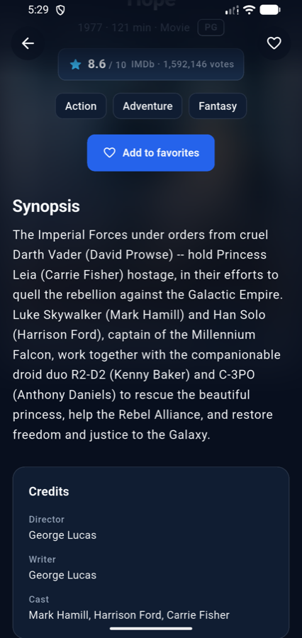 | 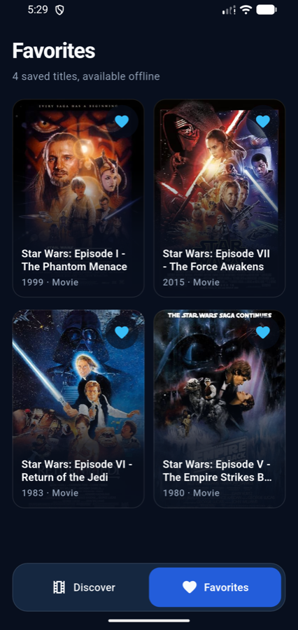 | 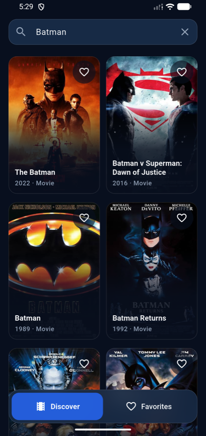 |

<a id="tangkapan-layar-ios"></a>
### iOS

Simulator iPhone 16e, iOS 18.3.

| Discover | Grid poster | Detail |
| --- | --- | --- |
| 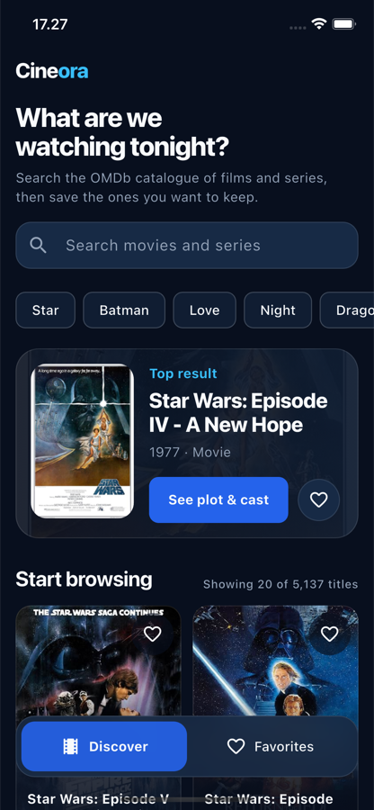 | 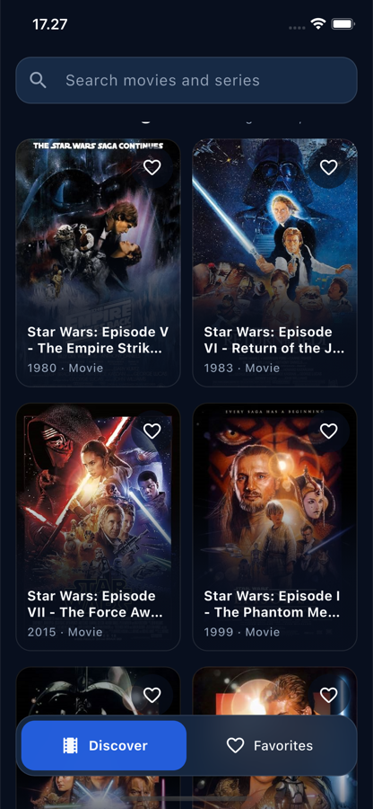 | 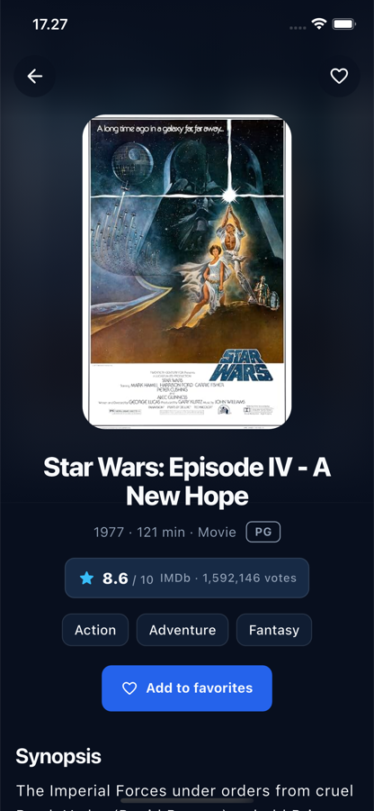 |

| Sinopsis & kredit | Favorites | Pencarian "Batman" |
| --- | --- | --- |
| 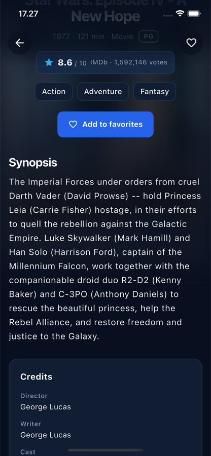 | 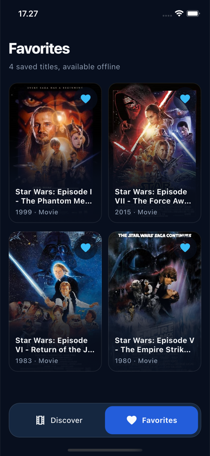 | 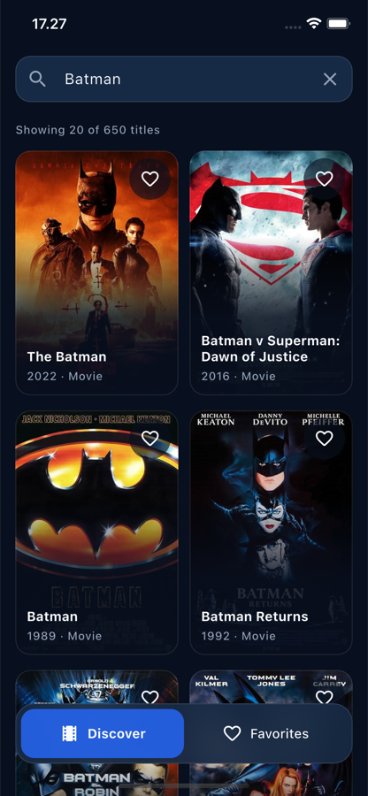 |

<a id="tangkapan-layar-lain"></a>
### Kondisi lain

| API key belum diisi (iOS) | Icon di home screen iOS |
| --- | --- |
| 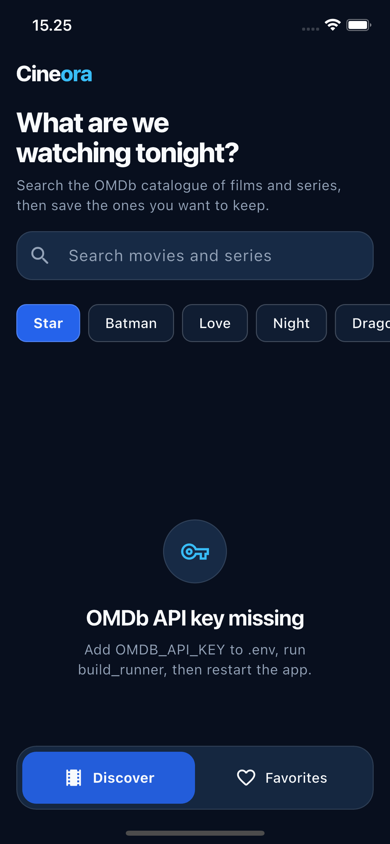 | 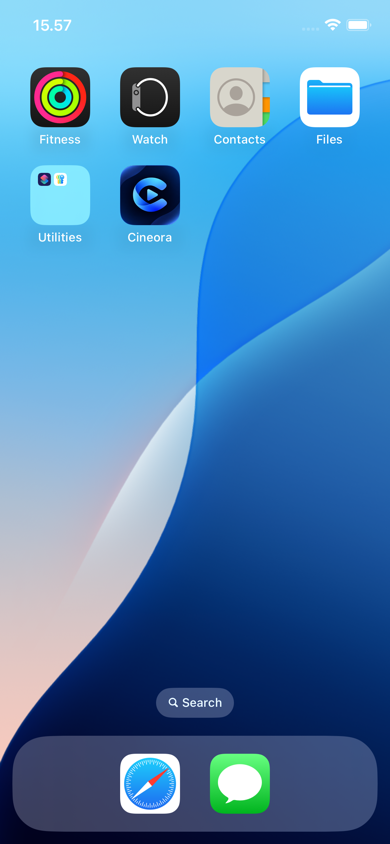 |

[↑ Kembali ke daftar isi](#daftar-isi)

---

<a id="teknologi"></a>
## 4. Teknologi

| Kebutuhan | Package | Versi |
| --- | --- | --- |
| State management, DI, routing | `get` | ^4.7.3 |
| HTTP client | `dio` | ^5.11.1 |
| Penyimpanan lokal | `get_storage` | ^2.1.1 |
| Konfigurasi environment | `envied` | ^1.3.10 |
| Gambar dan cache disk | `cached_network_image` | ^4.0.3 |
| Code generation `.env` (dev) | `envied_generator`, `build_runner` | ^1.3.10, ^2.15.1 |
| Generator icon aplikasi (dev) | `flutter_launcher_icons` | ^0.14.4 |

Tidak ada package runtime lain. Efek shimmer, permukaan glass, dan animasi dibuat dengan widget bawaan Flutter.

[↑ Kembali ke daftar isi](#daftar-isi)

---

<a id="arsitektur"></a>
## 5. Arsitektur

```
┌──────────────┐  observe   ┌───────────────────┐   call   ┌──────────────────────┐        ┌─────────────────────────┐
│ View         │ ─────────▶ │ ViewModel         │ ───────▶ │ Repository           │ ─────▶ │ Provider                │
│ (GetView)    │ ◀───────── │ (GetxController)  │          │                      │        │                         │
│ widget saja  │  Rx state  │ state, debounce,  │          │ MovieRepository      │        │ OmdbProvider (Dio)      │
│ navigasi     │            │ pagination, aksi  │          │ FavoriteRepository   │        │ FavoriteStorageProvider │
└──────────────┘            └───────────────────┘          └──────────────────────┘        │ (GetStorage)            │
                                                                                            └─────────────────────────┘
```

<a id="arsitektur-lapisan"></a>
### Lapisan MVVM

**View** (`modules/*/views`)
- Hanya merender state dan meneruskan aksi pengguna ke ViewModel.
- Tidak berisi request API, akses storage, maupun transformasi data.
- Navigasi dilakukan di View dengan `Get.toNamed`.

**ViewModel** (`modules/*/controllers`)

| Controller | Tanggung jawab |
| --- | --- |
| `HomeController` | Pencarian, debounce, pagination, deduplikasi, penanganan respons usang, toggle favorit |
| `DetailController` | Memuat detail berdasarkan IMDb ID, fallback ke salinan tersimpan saat offline, toggle favorit |
| `FavoritesController` | Daftar favorit, hapus, undo, kembali ke Discover |
| `RootController` | Tab aktif pada bottom navigation |

**Model** (`data/models`)
- `MovieSummary`: item hasil pencarian.
- `MovieDetail`: data lengkap dari endpoint detail.
- `SearchPage`: satu halaman hasil pencarian beserta `totalResults`.
- `FavoriteMovie`: favorit yang tersimpan, termasuk salinan detail untuk offline.
- `omdbValue()`: mengubah nilai `"N/A"` atau string kosong menjadi `null`.

**Repository** (`data/repositories`)
- `MovieRepository`: membungkus pencarian dan detail OMDb, membatasi halaman maksimal 100.
- `FavoriteRepository`: satu-satunya sumber data favorit. Berupa `GetxService` permanen yang menyimpan `RxMap` dan menulis setiap perubahan ke storage.

**Provider** (`data/providers`)
- `OmdbProvider`: membuat request dari `Env` dan memetakan error OMDb serta Dio ke `OmdbException` bertipe.
- `FavoriteStorageProvider`: membaca dan menulis JSON melalui GetStorage.

<a id="arsitektur-bindings"></a>
### Dependency injection (Bindings)

| Binding | Isi |
| --- | --- |
| `InitialBinding` | `OmdbProvider`, `MovieRepository` (lazy, `fenix`), `FavoriteRepository` (permanen) |
| `RootBinding` | `RootController`, lalu memanggil `HomeBinding` dan `FavoritesBinding` |
| `HomeBinding` | `HomeController(MovieRepository, FavoriteRepository)` |
| `DetailBinding` | `DetailController(MovieRepository, FavoriteRepository, arguments)` |
| `FavoritesBinding` | `FavoritesController(FavoriteRepository)` |

Semua dependency masuk lewat constructor, sehingga controller bisa diuji dengan fake repository.

<a id="arsitektur-routing"></a>
### Routing dan navigasi

| Route | Halaman | Keterangan |
| --- | --- | --- |
| `/` | `RootView` | Route awal. Menampung Home dan Favorites dalam `IndexedStack` dengan bottom navigation |
| `/home` | `HomeView` | Modul GetX CLI asli, tetap bisa dibuka mandiri |
| `/detail` | `DetailView` | Menerima `DetailArguments` (film dan hero tag). Transisi fade 320 ms |
| `/favorites` | `FavoritesView` | Modul GetX CLI asli, tetap bisa dibuka mandiri |

- `IndexedStack` menjaga kata kunci, hasil, dan posisi scroll saat berpindah tab.
- Tombol back Android di tab Favorites kembali ke tab Discover, tidak langsung keluar aplikasi.

[↑ Kembali ke daftar isi](#daftar-isi)

---

<a id="struktur-folder"></a>
## 6. Struktur folder

```
lib/
├── main.dart                              # inisialisasi GetStorage, tema, GetMaterialApp
└── app/
    ├── bindings/initial_binding.dart
    ├── core/
    │   ├── config/env.dart                # Envied (env.g.dart di-generate, tidak masuk Git)
    │   ├── theme/app_colors.dart          # token warna
    │   ├── theme/app_theme.dart           # ThemeData
    │   └── utils/responsive.dart          # gutter, jumlah kolom grid, breakpoint
    ├── data/
    │   ├── models/                        # MovieSummary, MovieDetail, SearchPage, FavoriteMovie
    │   ├── providers/                     # OmdbProvider, OmdbException, FavoriteStorageProvider
    │   └── repositories/                  # MovieRepository, FavoriteRepository
    ├── modules/                           # modul GetX CLI: bindings / controllers / views
    │   ├── root/                          # shell tab Discover + Favorites
    │   ├── home/views/widgets/            # header, search header, Top result, hasil, chip
    │   ├── detail/views/widgets/          # backdrop, header, bagian kredit dan detail
    │   └── favorites/
    ├── routes/                            # app_pages.dart, app_routes.dart
    └── shared/widgets/                    # komponen yang dipakai lintas halaman
test/
├── helpers/fakes.dart                     # fake repository dan storage
├── data/                                  # model, provider, repository favorit
├── modules/                               # HomeController, DetailController
└── widgets/                               # alur aplikasi, overflow, SliverFillMessage
assets/img/
├── Cineora.png                            # desain icon asli
└── launcher/                              # sumber icon iOS/Android yang dihasilkan darinya
docs/screenshots/                          # tangkapan layar untuk dokumentasi ini
```

[↑ Kembali ke daftar isi](#daftar-isi)

---

<a id="cara-kerja"></a>
## 7. Cara kerja fitur utama

<a id="cara-kerja-pagination"></a>
### Pagination 20 judul per batch

1. Setiap pencarian membuat objek `_SearchCursor` baru yang menyimpan kata kunci, halaman berikutnya, `totalResults`, dan himpunan IMDb ID yang sudah tampil.
2. Satu batch mengambil maksimal dua halaman OMDb (`pagesPerBatch = 2`), sehingga menghasilkan 20 judul.
3. Judul yang IMDb ID-nya sudah ada di himpunan dilewati.
4. `hasMore` bernilai `false` jika jumlah halaman yang dimuat sudah mencakup `totalResults`, halaman sudah melewati 100, atau OMDb mengembalikan halaman kosong.
5. View memanggil `loadMore()` saat sisa scroll kurang dari 900 px. Pemanggilan juga terjadi saat ukuran konten berubah, sehingga tablet dengan layar tinggi tetap memuat batch berikutnya.
6. Jika halaman kedua dalam satu batch gagal, judul dari halaman pertama tetap ditampilkan dan halaman yang gagal dicoba lagi pada pemuatan berikutnya.

<a id="cara-kerja-debounce"></a>
### Debounce dan respons usang

1. Setiap ketikan mengubah `query`. Worker `debounce` GetX menunggu 450 ms tanpa ketikan baru sebelum mencari.
2. Kata kunci dirapikan. Jika kosong, aplikasi kembali ke daftar awal. Jika kurang dari 2 huruf, tidak ada request.
3. Jika kata kunci sama dengan pencarian aktif yang sudah berhasil, tidak ada request baru.
4. Pencarian baru membatalkan request sebelumnya dengan `CancelToken` milik Dio.
5. Setiap respons dicek dengan `identical(cursor, _cursor)`. Respons dari cursor lama dibuang, sehingga balasan lambat untuk kata kunci lama tidak bisa menimpa hasil baru.

<a id="cara-kerja-sinkronisasi"></a>
### Sinkronisasi favorit antar halaman

- `FavoriteRepository` didaftarkan sekali sebagai `GetxService` permanen dan menyimpan favorit dalam `RxMap<String, FavoriteMovie>`.
- Semua controller membaca dan mengubah favorit lewat repository yang sama.
- Tombol favorit di setiap kartu dibungkus `Obx`, sehingga perubahan di satu halaman langsung terlihat di halaman lain tanpa reload.
- Setiap perubahan langsung ditulis ke GetStorage dengan kunci `favorite_movies`.

<a id="cara-kerja-offline"></a>
### Akses offline

- Saat halaman detail berhasil dimuat untuk judul yang sudah difavoritkan, data detail lengkap ikut disimpan bersama favorit tersebut.
- Jika request detail gagal (misalnya offline) dan salinan tersimpan ada, halaman detail menampilkan salinan itu disertai pemberitahuan "No connection. Showing the copy saved with your favorite."
- Poster diambil dari cache disk `cached_network_image`, sehingga poster yang pernah tampil tetap terlihat saat offline.
- Halaman Favorites sepenuhnya dibaca dari storage lokal dan tidak membutuhkan jaringan.

[↑ Kembali ke daftar isi](#daftar-isi)

---

<a id="desain-ui"></a>
## 8. Desain UI

Arah desain: **Midnight Blue Glassmorphism**. Permukaan biru gelap supaya warna datang dari poster film.

<a id="desain-palet"></a>
### Palet warna

| Token | Hex | Penggunaan |
| --- | --- | --- |
| `background` | `#080F1E` | Latar utama |
| `backgroundSecondary` | `#0D1729` | Latar sekunder |
| `surface` | `#101D32` | Panel solid, tile poster kosong |
| `glass` | `#172A45` | Kolom pencarian, permukaan glass, skeleton |
| `primary` | `#2563EB` | Isi tombol utama, tab dan chip aktif, fokus |
| `accent` | `#38BDF8` | Satu penanda per tampilan: "ora" di logo, bintang rating, hati favorit, label Top result |
| `textPrimary` | `#F8FAFC` | Teks utama |
| `textSecondary` | `#94A3B8` | Teks pendukung |
| `border` | `#FFFFFF1A` | Garis tepi tipis |

Kontras dihitung dengan rumus WCAG:

| Pasangan | Rasio | Hasil |
| --- | --- | --- |
| `textSecondary` di atas `background` | 7.46:1 | Lolos AA |
| `textSecondary` di atas `glass` | 5.63:1 | Lolos AA |
| `textPrimary` di atas `primary` | 4.94:1 | Lolos AA |
| `accent` di atas `background` | 8.93:1 | Lolos AA |
| `primary` sebagai teks di atas `background` | 3.70:1 | Gagal untuk teks normal, jadi `primary` tidak dipakai sebagai warna teks |

<a id="desain-glass"></a>
### Glassmorphism

Blur hanya dipakai di tempat konten bergerak di bawahnya:

- Bottom navigation, karena daftar film di-scroll di bawahnya.
- Strip pencarian yang pinned. Blur baru aktif saat hasil sudah lewat di bawahnya.
- Latar header detail berupa poster yang di-blur.

Kartu, panel, dan tombol di atas poster memakai permukaan solid agar mudah dibaca dan scroll tetap ringan.

<a id="desain-tipografi"></a>
### Tipografi dan animasi

- Font sistem (SF Pro di iOS, Roboto di Android) dengan bobot tebal dan tracking rapat untuk judul, tanpa package font tambahan.
- Animasi dipakai seperlunya:

| Animasi | Fungsi |
| --- | --- |
| Hero poster | Menjaga konteks saat berpindah dari kartu ke detail |
| Transisi fade 320 ms ke detail | Perpindahan halaman yang tenang |
| Skala singkat pada ikon hati | Konfirmasi bahwa ketukan diterima |
| Fade-in poster | Menghindari poster muncul tiba-tiba |
| Shimmer skeleton | Menunjukkan data sedang dimuat |

Semua animasi menjadi statis jika sistem meminta reduced motion.

<a id="desain-aksesibilitas"></a>
### Aksesibilitas

- Semua tombol ikon memiliki tooltip dan label semantik, misalnya "Add to favorites", "Remove from favorites", "Clear search", dan "Back".
- Kartu film dibacakan sebagai satu tombol: judul, tahun, tipe, lalu "Open details".
- Rating dibacakan sebagai "IMDb rating 8.7 out of 10".
- Target sentuh minimal 44 × 44 px.
- Pesan empty dan error menggunakan live region agar dibacakan screen reader.
- Status tidak hanya ditandai dengan warna. Tab aktif dan chip aktif juga mengubah ikon atau ketebalan teks.

<a id="desain-responsif"></a>
### Responsif

| Lebar konten | Kolom grid poster |
| --- | --- |
| < 300 px | 1 |
| 300–519 px | 2 |
| 520–719 px | 3 |
| 720–939 px | 4 |
| 940–1099 px | 5 |
| ≥ 1100 px | 6 |

- Lebar konten dibatasi 1180 px dan diletakkan di tengah.
- Gutter 16 px di ponsel dan 24 px mulai lebar 600 px.
- Mulai lebar 720 px, halaman detail menampilkan poster di samping info dan panel kredit dua kolom.
- Tinggi strip pencarian menyesuaikan ukuran teks sistem.
- Pesan empty dan error memakai `SliverFillMessage`. Pesan diletakkan di tengah jika muat dan bisa di-scroll jika ruang sempit, misalnya saat keyboard terbuka.

[↑ Kembali ke daftar isi](#daftar-isi)

---

<a id="shared-widgets"></a>
## 9. Shared widgets

Semua ada di `lib/app/shared/widgets/`.

| Widget | Fungsi | Dipakai di |
| --- | --- | --- |
| `GlassContainer` | Permukaan blur atau solid dengan border opsional | Bottom navigation, strip pencarian |
| `GlassSearchField` | Kolom pencarian dengan tombol clear dan indikator loading | Home |
| `MovieCard` | Kartu poster dengan judul, meta, dan tombol favorit | Home, Favorites |
| `MoviePoster` | Gambar dengan cache, Hero, dan fallback "No poster" | Kartu, Top result, Detail |
| `FavoriteButton` | Tombol hati dengan animasi dan haptic | Kartu, Top result, Detail |
| `RatingBadge` | Rating IMDb dan jumlah vote | Detail |
| `GlassBottomNavigation` | Tab Discover dan Favorites | Root |
| `LoadingShimmer`, `SkeletonBox` | Skeleton saat memuat | Home, Detail |
| `EmptyStateWidget` | Pesan kosong dengan aksi opsional | Home, Favorites |
| `ErrorStateWidget` | Pesan error dengan tombol Try again | Home, Detail |
| `StateMessage` | Tata letak bersama untuk empty dan error | `EmptyStateWidget`, `ErrorStateWidget` |
| `SliverMovieGrid` | Grid poster dengan jumlah kolom adaptif | Home, Favorites |
| `SliverFillMessage` | Menempatkan pesan state tanpa overflow | Home, Favorites |

[↑ Kembali ke daftar isi](#daftar-isi)

---

<a id="konfigurasi-environment"></a>
## 10. Konfigurasi environment

Cineora membaca konfigurasi OMDb dari `.env` melalui Envied. File `.env` dan hasil generate `lib/app/core/config/env.g.dart` sudah masuk `.gitignore`, dan API key diobfuskasi di kode hasil generate.

1. Daftar API key gratis di https://www.omdbapi.com/apikey.aspx, lalu aktifkan lewat link di email.
2. Salin template:
   ```bash
   cp .env.example .env
   ```
3. Isi `.env`:
   ```env
   OMDB_BASE_URL=https://www.omdbapi.com/
   OMDB_API_KEY=abcd1234
   ```
   > `OMDB_API_KEY` hanya berisi **8 karakter key**, bukan link lengkap dari email aktivasi, dan tanpa spasi di depannya.
4. Generate `env.g.dart`:
   ```bash
   fvm dart run build_runner clean
   fvm dart run build_runner build --delete-conflicting-outputs
   ```
   `build_runner clean` diperlukan setiap kali `.env` diubah, karena build_runner menyimpan cache isi `.env`.

Jika key kosong, aplikasi tetap berjalan dan menampilkan pesan "OMDb API key missing" tanpa mengirim request apa pun.

[↑ Kembali ke daftar isi](#daftar-isi)

---

<a id="instalasi"></a>
## 11. Instalasi dan menjalankan

Prasyarat: Flutter SDK dengan Dart ≥ 3.12 (proyek ini memakai [FVM](https://fvm.app/)), Android SDK, dan Xcode untuk iOS.

```bash
fvm flutter pub get
fvm dart run build_runner build --delete-conflicting-outputs
fvm flutter run
```

Setelah mengubah `.env`, lakukan **full restart**. Hot reload tidak membaca ulang nilai Envied.

[↑ Kembali ke daftar isi](#daftar-isi)

---

<a id="build-rilis"></a>
## 12. Build rilis, nama, dan icon aplikasi

```bash
fvm flutter build apk --release      # Android: build/app/outputs/flutter-apk/app-release.apk
fvm flutter build ios --release      # iOS: membutuhkan signing
```

**Nama aplikasi** adalah "Cineora" di semua platform:

| Platform | Lokasi |
| --- | --- |
| Android | `android:label` di `android/app/src/main/AndroidManifest.xml` |
| iOS | `CFBundleDisplayName` dan `CFBundleName` di `ios/Runner/Info.plist` |

**Icon aplikasi** dihasilkan dari `assets/img/Cineora.png`:

| File | Kegunaan |
| --- | --- |
| `assets/img/launcher/cineora_icon.png` | Desain asli dipotong pas ke kotak bulat, tanpa margin hitam. Untuk iOS dan icon Android lama |
| `assets/img/launcher/cineora_adaptive_foreground.png` | Hanya logo "C" dan play, diperkecil agar tidak terpotong mask lingkaran Android |
| Warna `#000C2A` | Latar adaptive icon Android, sama dengan warna dalam desain |

Untuk membuat ulang icon setelah desain berubah:

```bash
fvm dart run flutter_launcher_icons
```

Konfigurasinya ada di bagian `flutter_launcher_icons` pada `pubspec.yaml`.

**Splash screen** memakai warna latar aplikasi `#080F1E`, sehingga tidak ada layar putih saat aplikasi dibuka:

| Platform | Lokasi |
| --- | --- |
| Android ≤ 11 | `res/drawable/launch_background.xml` dan `res/drawable-v21/launch_background.xml` |
| Android 12+ | `android:windowSplashScreenBackground` di `res/values-v31/styles.xml` dan `res/values-night-v31/styles.xml` |
| Latar sebelum frame Flutter pertama | `NormalTheme` di semua `styles.xml` |
| Warna | `splash_background` di `res/values/colors.xml` |
| iOS | `backgroundColor` di `ios/Runner/Base.lproj/LaunchScreen.storyboard`, status bar putih lewat `UIStatusBarStyle` di `Info.plist` |

Build rilis Android saat ini masih ditandatangani dengan debug key (bawaan template Flutter). Untuk publikasi ke Play Store, tambahkan signing config sendiri dan ganti `applicationId` `com.example.cineora`.

[↑ Kembali ke daftar isi](#daftar-isi)

---

<a id="pengujian"></a>
## 13. Pengujian

```bash
fvm flutter analyze
fvm flutter test
```

Hasil terakhir: analyzer tanpa masalah, **53 test lulus**.

| File | Yang diuji |
| --- | --- |
| `test/data/models_test.dart` | Parsing hasil pencarian dan detail, `N/A` menjadi `null`, favorit tetap utuh setelah JSON round trip |
| `test/data/omdb_provider_test.dart` | Parameter request (`i`, `plot=full`, `s`, `page`, `apikey`), pemetaan "Movie not found!" dan 401 invalid key, key kosong tidak mengirim request |
| `test/data/favorite_repository_test.dart` | Tambah dan hapus, tanpa data ganda, toggle, tetap ada setelah restart, urutan terbaru, update detail, record rusak dilewati, file GetStorage benar-benar tertulis ke disk |
| `test/modules/home_controller_test.dart` | 20 judul dari dua halaman, load more dan deduplikasi, berhenti di `totalResults`, debounce menjadi satu request, 1 huruf tidak memanggil API, respons usang dibuang, clear search, empty, error dan retry, sinkronisasi favorit |
| `test/modules/detail_controller_test.dart` | Detail memakai IMDb ID yang diketuk, favorit dari detail menyimpan data lengkap, fallback offline, error jika offline dan belum tersimpan |
| `test/widgets/app_flow_test.dart` | Home dan Detail tanpa overflow di 320×568, 390×844, 430×932, 834×1194, 1366×1024, teks 1.6× di layar kecil, sinkronisasi favorit antar tab, undo, empty state, error dan retry, pencarian tanpa hasil, keyboard terbuka saat "Too many matches", tidak ada filter aktif saat aplikasi dibuka, akhir daftar |
| `test/widgets/sliver_fill_message_test.dart` | Pesan state tidak terpotong saat ruang lebih kecil dari estimasi tinggi, dan tetap di tengah saat muat |

Test memakai fake repository dari `test/helpers/fakes.dart`, sehingga tidak membutuhkan jaringan maupun API key.

[↑ Kembali ke daftar isi](#daftar-isi)

---

<a id="penanganan-error"></a>
## 14. Penanganan error

`OmdbProvider` mengubah setiap kegagalan menjadi `OmdbException` dengan tipe berikut:

| `OmdbFailure` | Pemicu | Judul pesan | Tombol coba lagi |
| --- | --- | --- | --- |
| `missingApiKey` | `OMDB_API_KEY` kosong | OMDb API key missing | Tidak |
| `invalidApiKey` | OMDb: "Invalid API key!" atau "No API key provided." | OMDb rejected the API key | Tidak |
| `requestLimit` | OMDb: "Request limit reached!" | Daily request limit reached | Ya |
| `network` | Tidak ada koneksi | You appear to be offline | Ya |
| `timeout` | Koneksi 10 detik atau respons 15 detik terlewati | OMDb is taking too long | Ya |
| `notFound` | "Movie not found!" atau "Incorrect IMDb ID." | Ditampilkan sebagai empty state | Tidak |
| `tooManyResults` | "Too many results." | Too many matches | Tidak, pengguna diminta menambah huruf |
| `server` | Respons tidak terduga atau status HTTP lain | OMDb returned an error | Ya |
| `cancelled` | Request dibatalkan oleh pencarian baru | Tidak ditampilkan | |

[↑ Kembali ke daftar isi](#daftar-isi)

---

<a id="pemecahan-masalah"></a>
## 15. Pemecahan masalah

**"OMDb rejected the API key" padahal key sudah diaktifkan**
- Pastikan `OMDB_API_KEY` hanya berisi 8 karakter key. Kesalahan yang sering terjadi adalah menempel link lengkap dari email aktivasi (`http://www.omdbapi.com/?i=...&apikey=xxxxxxxx`).
- Hapus spasi sebelum atau sesudah key.
- Uji key langsung:
  ```bash
  curl "https://www.omdbapi.com/?apikey=KEY_ANDA&s=star"
  ```

**Key sudah diganti tetapi aplikasi masih memakai key lama**
- build_runner menyimpan cache `.env`. Jalankan:
  ```bash
  fvm dart run build_runner clean
  fvm dart run build_runner build --delete-conflicting-outputs
  ```
- Lakukan full restart aplikasi, bukan hot reload.

**"OMDb API key missing"**
- `.env` belum ada atau `OMDB_API_KEY` kosong. Ikuti [Konfigurasi environment](#konfigurasi-environment).

**"Too many matches"**
- Kata kunci terlalu umum, misalnya dua huruf. Tambahkan beberapa huruf lagi.

**Release APK tidak bisa memuat data**
- Pastikan `<uses-permission android:name="android.permission.INTERNET" />` ada di `android/app/src/main/AndroidManifest.xml`. Izin ini sudah ditambahkan di proyek ini.

**Icon tidak berubah di perangkat**
- Hapus aplikasi dari perangkat lalu install ulang. Launcher sering menyimpan cache icon lama.

[↑ Kembali ke daftar isi](#daftar-isi)

---

<a id="pemenuhan-requirement"></a>
## 16. Pemenuhan requirement

| Requirement | Implementasi | Bukti |
| --- | --- | --- |
| Menampilkan 20 film | Dua halaman OMDb per batch | `first load shows 20 titles from two OMDb pages` |
| Poster, judul, tahun, tipe | `MovieCard`, `FeaturedMovieCard` | Widget test Home |
| IMDb ID sebagai identifier | Kunci deduplikasi, favorit, dan argumen detail | `loads detail for the IMDb id that was tapped` |
| Pagination | Infinite scroll, `loadMore()` | `loadMore appends the next 20 and skips duplicate ids` |
| Tanpa data ganda | `_SearchCursor.seenIds` | Test yang sama |
| Pull-to-refresh | `RefreshIndicator` → `refreshMovies()` | Kode `home_view.dart` |
| Skeleton loading | `LoadingShimmer`, `SkeletonBox` | Kode `home_results.dart`, `detail_sections.dart` |
| Poster kosong | Tile "No poster" | `search page parses items and treats N/A poster as missing` |
| Empty dan error | `EmptyStateWidget`, `ErrorStateWidget` | Widget test empty dan error |
| Detail lengkap dengan full plot | `?i=…&plot=full` | `detail requests the given IMDb id with the full plot` |
| Live search dengan debounce | `debounce` 450 ms | `typing is debounced into a single request` |
| Respons usang aman | Cursor per pencarian dan `CancelToken` | `an outdated response never replaces newer results` |
| Clear search | Tombol × → `clearSearch()` | `clearing search goes back to the default list` |
| Tambah dan hapus favorit | `FavoriteRepository.toggle()` | `add and remove update state and storage` |
| Favorit bertahan setelah restart | GetStorage | `favorites survive a restart`, `GetStorage provider writes favorites to disk` |
| Tanpa favorit ganda | `RxMap` dengan kunci IMDb ID | `adding the same title twice keeps one record` |
| Sinkron antar halaman | Satu `FavoriteRepository` permanen dan `Obx` | `favorite set on Home shows on Favorites and detail` |
| Akses offline | Detail tersimpan bersama favorit dan cache poster | `offline favorite falls back to the saved copy` |
| Responsif tanpa overflow | `LayoutBuilder`, grid adaptif, `SliverFillMessage` | Widget test di 5 ukuran layar dan teks 1.6× |
| MVVM + GetX CLI | Modul `bindings/controllers/views` | [Arsitektur](#arsitektur) |
| Envied, tanpa hardcode key | `Env.omdbApiKey`, `.env` di-ignore | [Konfigurasi environment](#konfigurasi-environment) |

[↑ Kembali ke daftar isi](#daftar-isi)

---

<a id="batasan"></a>
## 17. Batasan yang diketahui

- OMDb tidak punya endpoint trending atau populer, sehingga daftar awal adalah hasil pencarian "star". Di layar daftar ini diberi judul "Start browsing" dan tidak menandai chip mana pun.
- Key OMDb gratis dibatasi 1.000 request per hari. Saat kuota habis, aplikasi menampilkan pesan khusus dan favorit tetap bisa dibuka.
- Favorit yang disimpan dari kartu daftar hanya berisi data ringkas sampai halaman detailnya dibuka sekali saat online.
- Poster yang belum pernah ditampilkan tidak tersedia saat offline dan diganti tile "No poster".
- Build rilis Android masih memakai debug signing dan `applicationId` bawaan template.

[↑ Kembali ke daftar isi](#daftar-isi)
